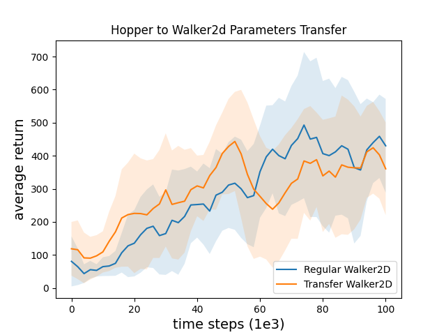
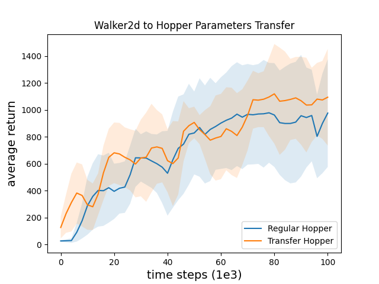
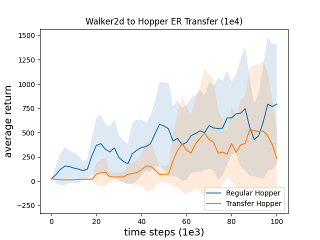
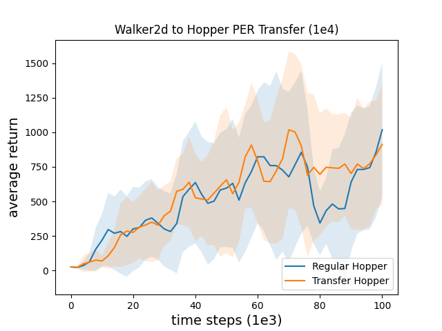

# Transfer Learning in Deep Deterministic Policy Gradient

**Hamin Cheon · Undergraduate thesis · University of Groningen · 2022**

## Research Overview

Can a DDPG agent trained for one simulated locomotion task give an agent a head start on another? This thesis compares three ways to transfer information between PyBullet's Hopper and Walker2D tasks using uniform replay buffers, prioritized replay buffers, and actor–critic parameters.

**Parameter transfer increased the area under the target learning curve by 4.3% from Hopper to Walker2D and 11.9% from Walker2D to Hopper.** Replay-buffer transfer lowered this metric in 11 of 12 tested settings. [Results and figures](#experimental-results-and-visualizations) · [Full thesis](#full-undergraduate-thesis)

## Research Questions and Motivation

Continuous-control agents learn from repeated interactions with their environment. Reusing experience or trained weights could improve learning within a fixed target-task training budget. The study asks whether either approach helps DDPG when the source and target robots have different observation and action dimensions, and whether the outcome of buffer transfer depends on the sampling method, buffer capacity, or transfer direction.

## DDPG and Transfer Learning Methodology

DDPG is an off-policy actor–critic algorithm for continuous actions. The actor maps observations to actions, the critic estimates their value, and slowly updated target networks supply targets for critic training. Replay supplies past transitions for minibatch updates. Standard experience replay (ER) samples uniformly. Prioritized experience replay (PER) favors transitions with larger absolute temporal-difference errors. The archived implementation uses prioritization for sampling and sets the loss weights to one.

```text
Train DDPG on the source task
  ├─ Buffer transfer: adapt transitions and prefill replay
  └─ Parameter transfer: adapt actor and critic weights
For each condition: train on the target task and compare with its baseline
```

The thesis reports 100,000 training steps on each task. It evaluates policies at initialization and every 2,000 steps using mean undiscounted return over 10 episodes. The target-only baseline starts with randomly initialized networks and an empty replay buffer.

## Experimental Environments

| PyBullet environment | Simulated task | Observation dimensions | Continuous action dimensions |
| --- | --- | ---: | ---: |
| `HopperBulletEnv-v0` | Forward locomotion with one leg | 15 | 3 |
| `Walker2DBulletEnv-v0` | Forward locomotion with two legs | 22 | 6 |

The study tests both transfer directions. Hopper → Walker2D appends seven observation and three action components using zeros. Walker2D → Hopper retains the first 15 observation and first three action components. Parameter transfer applies the corresponding padding or truncation to the dimension-dependent actor and critic weights.

## ER, PER, and Parameter Transfer Experiments

| Condition | Target agent's actor and critic | Initial target replay buffer | Configurations |
| --- | --- | --- | --- |
| Standard ER buffer transfer | Random | Adapted source transitions, sampled uniformly | Both directions at 10,000, 100,000, and 1,000,000 transitions |
| PER buffer transfer | Random | Adapted source transitions, sampled by priority | Both directions at the same three capacities |
| Parameter transfer | Adapted source actor and critic, with target copies initialized from them | Empty | Both directions |

For buffer transfer, a trained source policy collects a fresh set of transitions to fill the buffer. The conversion changes observations and actions while retaining source rewards and termination flags. In the archived parameter-transfer implementation, the target copies are synchronized to the adapted actor and critic and optimizer state starts fresh.

## Experimental Results and Visualizations

Values are the percentage change in area under the **target-task** learning curve relative to the corresponding target-only baseline, from thesis Tables 4.4–4.6. Each ER and PER value links to its original plot.

| Transfer method | Buffer capacity tested | Hopper → Walker2D | Walker2D → Hopper |
| --- | ---: | ---: | ---: |
| Standard ER | 10,000 | [−27.9%](Plots/H2W_ER_1e4.png) | [−48.9%](Plots/W2H_ER_1e4.png) |
| Standard ER | 100,000 | [−69.6%](Plots/H2W_ER_1e5.png) | [−85.4%](Plots/W2H_ER_1e5.png) |
| Standard ER | 1,000,000 | [−92.4%](Plots/H2W_ER_1e6.png) | [−95.1%](Plots/W2H_ER_1e6.png) |
| PER | 10,000 | [−10.6%](Plots/H2W_PER_1e4.png) | [+10.5%](Plots/W2H_PER_1e4.png) |
| PER | 100,000 | [−41.8%](Plots/H2W_PER_1e5.png) | [−30.8%](Plots/W2H_PER_1e5.png) |
| PER | 1,000,000 | [−80.9%](Plots/H2W_PER_1e6.png) | [−74.7%](Plots/W2H_PER_1e6.png) |
| Parameters | — | **+4.3%** | **+11.9%** |

| Hopper → Walker2D | Walker2D → Hopper |
| --- | --- |
|  |  |

*Thesis Figure 4.5. Blue is target-only training and orange is parameter transfer. Lines show the smoothed mean evaluation return across five runs. Shading shows one standard deviation above and below the mean, with the same smoothing.*

<details>
<summary>Compare uniform and prioritized replay at 10,000 transitions</summary>

| Walker2D → Hopper, standard ER (−48.9%) | Walker2D → Hopper, PER (+10.5%) |
| --- | --- |
|  |  |

*Thesis Figures 4.2(a) and 4.4(a). Blue is target-only training and orange is buffer transfer.*

</details>

## Key Findings and Limitations

- **Replay-buffer transfer generally hurt learning.** ER reduced learning-curve area in all six settings. PER reduced it in five of six, with Walker2D → Hopper at 10,000 transitions as the exception. Relative performance worsened with larger buffers in both directions for each sampling method.
- **Parameter transfer improved early performance in both directions.** The thesis also reports higher mean peak returns in both directions. At the end of the measured training window, parameter transfer had lower mean return on Walker2D and higher mean return on Hopper.
- **The evidence is limited to two simulated tasks and five runs per curve.** The plots show substantial run-to-run variability and overlapping standard-deviation bands. The reported differences are descriptive.
- **The transfer mapping and training budget matter for interpretation.** Padding and truncation align tensor dimensions, and the study leaves open how other mappings would affect learning. The reported areas cover target-task training. Source training and buffer collection add work outside that window.

## Repository Structure

| Path | Contents |
| --- | --- |
| [`DDPG_self/`](DDPG_self/) | DDPG and replay-buffer implementation, experiment scripts with in-file settings, and plotting code |
| [`DDPG_self/data/Experiment/`](DDPG_self/data/Experiment/) | Archived return arrays for the thesis comparisons and additional trials |
| [`DDPG_self/data/`](DDPG_self/data/) | Other archived experiment outputs alongside the thesis comparison arrays |
| [`Plots/`](Plots/) | Original thesis comparison plots |
| [`DDPG_self/result_plots/`](DDPG_self/result_plots/) | Additional archived plots |
| [`docs/reproduction.md`](docs/reproduction.md) | Dependency setup, script map, and verification details |

## Installation and Reproduction Instructions

The original training scripts use the legacy Gym API and PyBullet environment registration. The archived figures can be viewed directly and the return arrays can be checked without the simulator. See the [reproduction guide](docs/reproduction.md) for installation, plotting commands, and the limits of rerunning the study.

## Full Undergraduate Thesis

Hamin Cheon (2022). *A Transfer Learning Analysis of the Deep Deterministic Policy Gradient Method*. Bachelor's project thesis, University of Groningen. Methods are in Section 3, results in Section 4, and limitations in Section 5. [Read the original thesis (PDF)](Bachelor_s_Project_Hamin_Cheon-3.pdf)

The thesis cites Jonathan Pearce's DDPG with prioritized experience replay implementation as an implementation reference. [DDPG_PER](https://github.com/Jonathan-Pearce/DDPG_PER)
